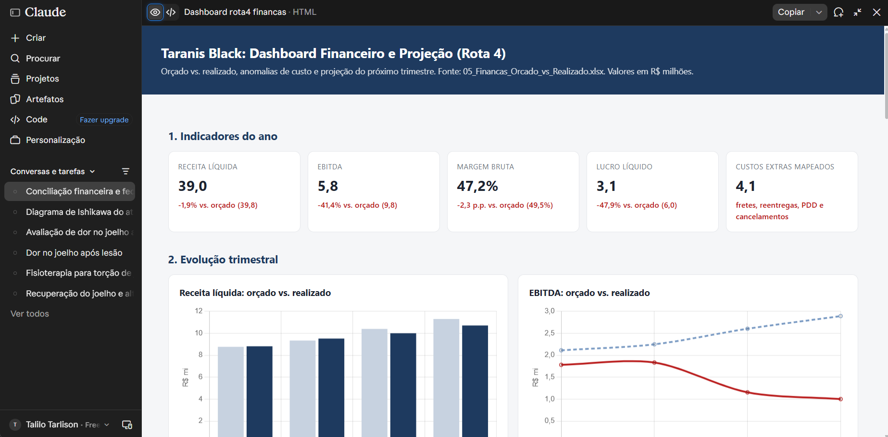

# Rota 4: IA para Finanças e Operações (Taranis Black)

Projeto do Challenge ONE AI for Business (G11). Analisa o desempenho financeiro e operacional da empresa simulada Taranis Black, identifica os gargalos que afetam o resultado e projeta o próximo trimestre com base nos dados realizados.

## O que o projeto faz

A partir da planilha de Orçado vs. Realizado, o projeto:

1. **Valida os dados.** Confere se os totais da DRE batem com as linhas e se a receita por produto bate com a receita bruta.
2. **Compara orçado e realizado** por trimestre, separando desvios pontuais de tendências.
3. **Identifica anomalias** de custo e receita, com hipóteses de causa baseadas no diagnóstico operacional (SIPOC e Ishikawa).
4. **Projeta o próximo trimestre** por regressão linear simples, linha a linha, e recalcula o EBITDA a partir das projeções. São apresentados três cenários: inércia, estabilização no nível do último trimestre e captura parcial dos ganhos de um plano de intervenção.
5. **Gera um dashboard HTML** autocontido com indicadores, gráficos, DRE completa, anomalias e projeção.

## Principais achados

- O EBITDA realizado ficou em R$ 5,8 mi, 41% abaixo do orçado de R$ 9,8 mi.
- A receita líquida ficou próxima do orçado (-1,9%), então o problema está na operação, não na demanda.
- Fretes de emergência, reentregas, inadimplência (PDD) e cancelamentos por atraso logístico crescem a cada trimestre.
- A margem bruta caiu cerca de 3 pontos percentuais no segundo semestre.
- A projeção de inércia para o próximo trimestre é de EBITDA em torno de R$ 0,7 mi.

## Estrutura do projeto

```
.
├── README.md                          Este arquivo
├── dashboard_rota4_financas.html      Dashboard interativo (abre no navegador)
└── 05_Financas_Orcado_vs_Realizado.xlsx   Dados de entrada (não incluído, ver Fontes)
```

## Como usar

1. Abra `dashboard_rota4_financas.html` em qualquer navegador moderno.
2. É necessária conexão com a internet, porque os gráficos usam Chart.js pelo CDN do cdnjs.
3. Para reproduzir a análise, use a planilha de entrada com os prompts de limpeza, análise, projeção e geração do dashboard descritos no relatório da Etapa 3.

## Fontes de dados

Todos os dados são simulados e foram preparados para o challenge. Os arquivos de origem são:

- `05_Financas_Orcado_vs_Realizado.xlsx`: DRE trimestral, receita por linha de produto e indicadores de gargalos.
- `06_Descritivo_Processo_Operacional_SIPOC`: fluxo operacional de aprovação, faturamento e expedição, usado para o diagnóstico de causas.

## Premissas e limitações

- **Amostra pequena.** A projeção usa apenas quatro trimestres. Regressão com quatro pontos é uma estimativa indicativa, não uma previsão confiável.
- **Sem sazonalidade.** A planilha tem um único ano, então não é possível modelar padrões sazonais.
- **Sem efeito de preço ou mix.** A projeção não considera reajuste de tabela nem mudança na composição de produtos.
- **Captura de ganhos é uma premissa.** O cenário C assume que 40% dos ganhos potenciais de um plano de intervenção se materializam no primeiro trimestre. Esse percentual não é medido, é uma hipótese.

## Inconsistências nos dados de origem

Antes de apresentar os números a uma diretoria, estes pontos devem ser explicados:

- A aba de linhas de produto soma R$ 47,4 mi de receita realizada, enquanto a DRE mostra R$ 48,5 mi de receita bruta.
- A aba de gargalos cita R$ 960 mil por ano em fretes duplicados, enquanto o desvio combinado de frete e reentregas na DRE é de cerca de R$ 1,9 mi. Os dois números têm escopos diferentes.

## Limitações gerais

Este projeto é uma análise didática com dados simulados. Não substitui parecer contábil, auditoria nem decisão de investimento. Os enquadramentos jurídicos citados nas políticas de governança e de LGPD precisam ser validados pelo jurídico da empresa.

## Contexto

Entrega da Rota 4 do Challenge ONE AI for Business (G11), Taranis Black. Os entregáveis completos incluem o Resumo Executivo, a Rota 0 (AI Canvas, priorização e governança), o diagnóstico SIPOC e Ishikawa e este dashboard.

## Imagens Anexo

